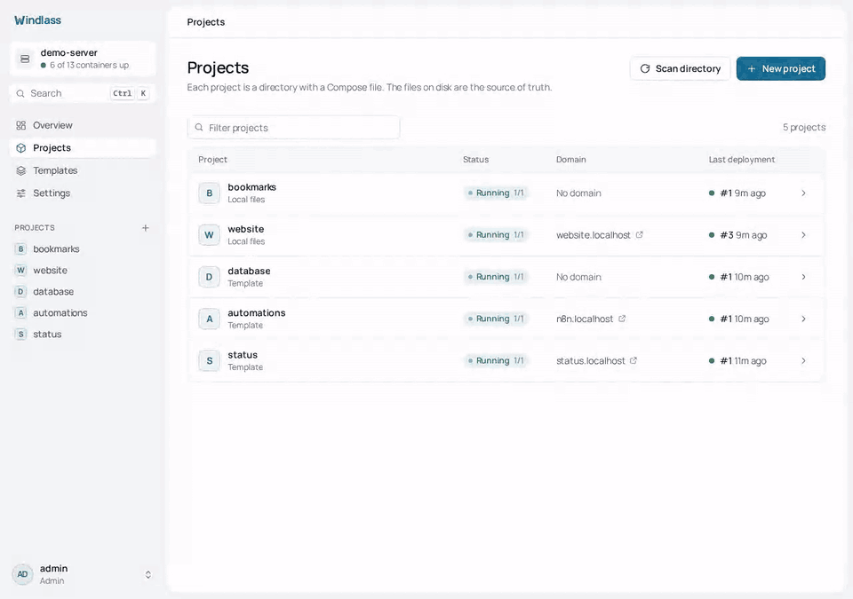

# Windlass

**A self-hosted panel for Docker Compose that never rewrites your compose file.**

[](https://github.com/Sulaiman-Dauda/windlass/releases/latest) [](LICENSE)

Windlass gives one server Git deployments, HTTPS domains, logs, a terminal, metrics,
backups and users, and does all of it by running the real `docker compose` CLI on your own
`compose.yaml`. No Swarm, no Postgres, no Redis: one Go binary, one SQLite file and Caddy.
The process idles at about 24 MB, and CI fails any build that reaches 40 MB.



```sh
curl -fsSL https://get.windlass.run | sudo sh
```

Runs on Linux, x86_64 or arm64. Claiming the instance and setting the panel domain are under
[Install](#install).

## Why Windlass

- **Your compose file stays yours.** Windlass adds no labels, networks or renamed volumes to
  it. Routes go to Caddy through its API, so `docker compose up -d` by hand still works, and
  the panel reads the same files you edit.
- **The panel is not in the request path.** Stop Windlass and your sites keep serving: the
  containers are ordinary Compose containers with a restart policy, and Caddy keeps its
  routes. See [life without the panel](docs/life-without-the-panel.md).
- **Nothing to migrate off.** Everything that defines an app is a plain file in
  `/var/lib/windlass/projects/<name>/`. Uninstall Windlass and you keep a folder of Compose
  projects that run with `docker compose` alone.
- **Small enough for the cheapest VPS.** No database server or cache to feed besides your apps.

## How it compares

Checked against each project's own docs and source on 30/10/2026. Corrections welcome.

| | Windlass | Coolify | Dokploy | CapRover | Dokku |
|---|---|---|---|---|---|
| Deploys your compose file with | `docker compose`, file unchanged | its own labels, networks and volume names added ("Raw" mode leaves it mostly alone) | `docker compose`, Traefik labels written into the file | converted into CapRover apps; `build`, `networks` and `deploy` ignored | no compose support; git push, image or archive |
| Runs alongside | Caddy, SQLite | Postgres, Redis, Traefik or Caddy | Docker Swarm, Postgres, Traefik | Docker Swarm, nginx | nginx (other proxies optional) |
| Stated server minimum | none; the panel idles at about 24 MB | 2 GB RAM | 2 GB RAM | 1 GB RAM recommended | 1 GB RAM |
| Licence | Apache-2.0 | Apache-2.0 | Apache-2.0, except `/proprietary` | Apache-2.0 | MIT |

If you want a Heroku-style git push workflow, Dokku is the better fit. If you already write
Compose files and want a panel that leaves them alone, that is what Windlass is for.


More screens in [docs/screenshots](docs/screenshots/), and the full guides at
[windlass.run](https://windlass.run).

## Source-of-truth model

Application configuration lives under the projects directory:

```text
<projects>/<name>/
├── compose.yaml       # services, images, ports, volumes, networks, env references, limits
├── .env               # optional standard dotenv file; mode 0600
└── .windlass.json     # source repository, branch, auto-deploy, and domains
```

Windlass executes the real `docker compose` CLI in that directory. Hand-editing the files
and running `docker compose up -d` is supported. The Files and Environment screens read the
same files, and **Scan directory** rebuilds the SQLite project/domain index.

SQLite is not application configuration. It contains platform state such as users, sessions,
audit entries, deployment history, jobs, backup records, settings, encrypted credentials,
and rebuildable project/domain/environment indexes. Removing SQLite does not stop running
containers; filesystem scanning restores the application index, but platform history and
accounts require a platform backup.

## Runtime model

- One Go process serves the API and embedded React frontend.
- Docker Compose performs deployments.
- Caddy owns routing and certificates. Windlass changes only its tagged route objects.
- A loopback-only Docker socket proxy exposes the API families Compose needs. The `windlass`
  system user is not a member of the `docker` group.
- No Redis, Kubernetes, Swarm, Prometheus, or separate job service is required.
- CI enforces an idle RSS budget below 40 MiB for the Go process.

Stopping or removing Windlass does not stop deployed applications. See
[Life without the panel](docs/life-without-the-panel.md).

## Main features

- Manual, Git, webhook, template, and rollback deployments
- Crash-resumable deployment jobs and replayable deployment events
- [Staging](docs/staging.md) per project: pushes deploy to a copy with its own domains and data,
  and Promote deploys the commit and image digests it verified to live
- Caddy application domains and a Settings-managed HTTPS domain for the panel itself
- Raw file editing plus individual or bulk-paste environment variable editing
- Compose-native CPU/memory limit visibility and application readiness checks
- Container logs, browser terminal, host/container metrics, and image cleanup
- Local and S3-compatible backups with optional schedules
- Local users, roles, TOTP, and optional GitHub or Google sign-in
- Personal API tokens, read-only or read-write, for scripts and CI
- Private registry credentials, applied to the host with a real `docker login`
- Optional external-process plugins

Application readiness is configured with ordinary Compose labels:

```yaml
services:
  web:
    labels:
      windlass.health.url: https://app.example.com/health
      windlass.health.status: "200"
      windlass.health.contains: ready
      windlass.health.stability_seconds: "10"
```

## Install

```sh
curl -fsSL https://get.windlass.run | sudo sh
```

Claim the instance using the one-time token from `sudo journalctl -u windlass | grep
setup_token`, then open **Settings, General, Panel domain** after pointing a DNS record at
the server. Caddy obtains and
renews the panel certificate automatically.

See [Installation](docs/install.md) for systemd, container, configuration, update, and
uninstall details.

## Development and verification

```sh
go test ./...
go vet ./...
cd web && npm ci && npm run build
go test -tags integration ./...   # Linux with Docker and Caddy
```

The production binary embeds `web/dist`:

```sh
CGO_ENABLED=0 go build -trimpath -tags embedweb ./cmd/windlass
```

## Licence

Apache-2.0
