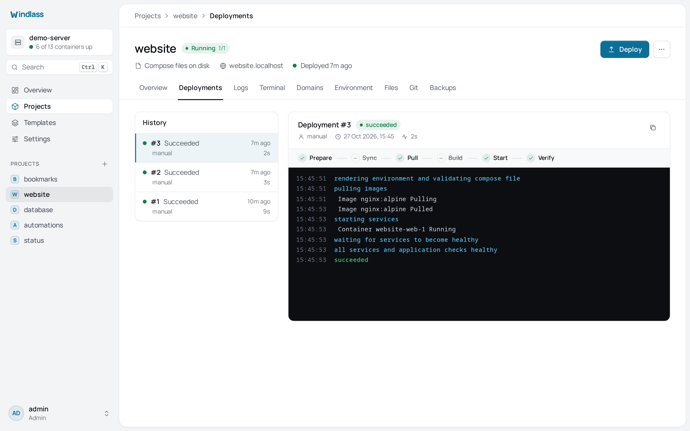

# Deployments

A deployment is a resumable state machine, not a single `docker compose up`. It runs a
fixed sequence and records every step:

```text
Prepare -> Sync -> Pull -> Build -> Start -> Verify
```

The log streams to the Deployments tab as it goes, and is kept afterwards, so a
deployment that failed last Tuesday still has its output.



## The steps

**Prepare** reads `.env` and runs `docker compose config`, refusing to continue if the
file is invalid, so a typo fails before anything is stopped. **Sync** fetches the Git
revision when the project has a repository. **Pull** fetches images, and **Build** builds
the services that have a `build:` key. **Start** hands over to `docker compose up -d
--remove-orphans`.

**Verify** is the step that separates a deployment from a command. Windlass waits up to
two minutes for every container to be running, for Docker healthchecks to report
healthy, and for any `windlass.health.*` labels to pass. A stack that starts and
immediately crash-loops is a failed deployment, not a green one, and the failure is
recorded with its reason. A service that exits with code 0, such as a migration job,
counts as done.

One deployment runs per project at a time. Deploying while one is running is refused.

## Interruptions

If the panel restarts mid-deployment, the deployment resumes on startup from the step it
was in. Jobs are reclaimed by their `running` status rather than being abandoned, so a
server reboot at the wrong moment does not leave a project half-updated with nobody
watching.

## Rollback

Every deployment is numbered, and any earlier deployment that succeeded can be rolled back
to from the Deployments list. A rollback is a new deployment through the same state
machine, verification included, so a rollback that would not come up healthy fails
visibly rather than quietly leaving you worse off.

What it restores:

- **Pulled images** are pinned to the digests recorded when that deployment ran, through a
  generated `compose.rollback.yaml` beside your compose file. A tag that has moved since,
  such as `latest`, still gets the old image.
- **On a Git project**, the recorded commit is checked out in `src/` and the services with
  a `build:` key are built from it, so the code goes back too.
- **Without Git**, a service built on the server keeps its current image, and the log says
  so. Windlass has no earlier copy of its source to build from.

A rollback uses the compose file and `.env` as they are now, not as they were. If the
deployment you are undoing changed either, change it back before rolling back.

## Git deployments

Connect a repository in the project's Git tab with its `https://` clone URL. A public
repository needs nothing else. For a private one, an admin first adds a connection under
**Settings, Git**: GitHub by installing the GitHub App, with **Connect GitHub**, or with a
token, and GitLab with a token. Windlass stores the repository, branch and auto-deploy preference in
`.windlass.json`, in the project directory, next to the compose file.

The repository is checked out into `src/` inside the project directory. The project's own
`compose.yaml` is what runs, so point its build at the checkout with `build: ./src`. See
[Projects and Compose](./projects-and-compose.md#git-projects).

With auto-deploy on, a push to the configured branch triggers a deployment, and pushes to
other branches are ignored. When the project uses a connection, Windlass registers the
webhook on the repository for you. If it cannot, the Git tab shows the URL and secret to
paste into the repository's webhook settings, once. Windlass checks every delivery, the
GitHub signature or the GitLab secret token, so an unsigned or wrongly signed request
deploys nothing.

A push that arrives while a deployment is already running is skipped, not queued. Deploy
by hand, or push again, once the running one has finished.

Manual is the default. A project only auto-deploys because you asked it to.

## Private registries

Images from private registries need credentials, which an admin adds under **Settings,
Registries**. Windlass logs the host in before each pull, and warns in the deployment log
when an image's registry has no credential. A GitHub connection can fill in a `ghcr.io`
credential directly, which saves generating a token by hand for the common case.

## What a deployment does not do

It does not reconstruct your container specification. Windlass shells out to `docker
compose`, so what runs is what your compose file says, interpreted by Compose itself.
The panel is not a translation layer that can disagree with it.
