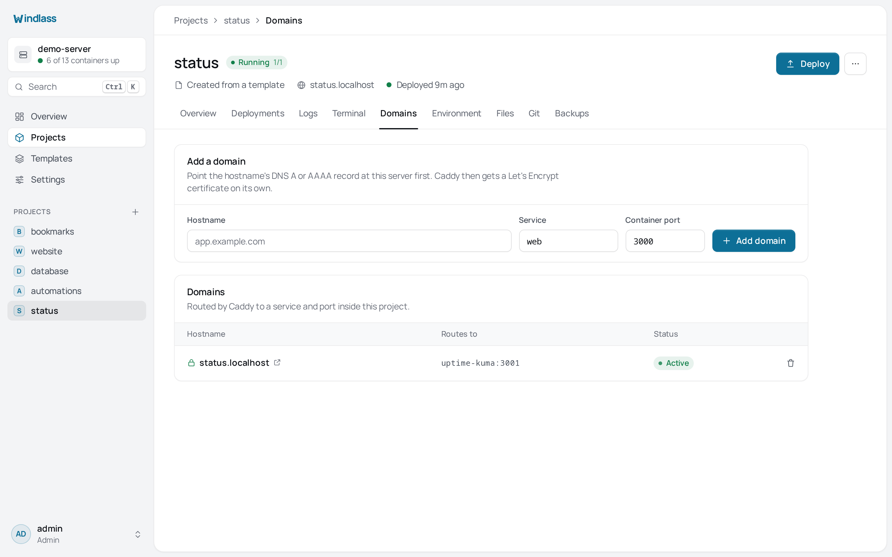

# Domains and HTTPS

Windlass drives Caddy. Add a hostname to a project, point DNS at the server, and a
certificate arrives on the first request. There is no certificate paperwork and no renewal
to remember.

## Adding a domain

In the project's Domains tab, enter the hostname and choose the service and container port
to route to. Caddy connects to the container on its Docker network, so the port does not
need to be published on the host.

Windlass writes the route once the service has a running container, and moves it when the
container restarts with a new address. The tab shows where each domain stands:

- **Active**: the route is in Caddy.
- **Waiting for container**: the service has no running container yet, so there is
  nothing to route to. Deploy the project.
- **Proxy unavailable**: Windlass cannot reach Caddy's admin API.

Active means routed, not certified. Windlass does not check DNS or the certificate.
Caddy requests the certificate, from Let's Encrypt by default, and it usually arrives
within seconds of the route being written. Plain HTTP requests to the hostname are
redirected to HTTPS.

DNS must already point at the server. Let's Encrypt validates by connecting to the name,
so a hostname that does not resolve, or resolves elsewhere, cannot be issued a
certificate. When an Active domain has no certificate, check the A record first, then
Caddy's log, as [Troubleshooting](./troubleshooting.md#a-domain-has-no-certificate)
describes.

## What Windlass touches, and what it does not

This matters if Caddy also serves things you configured yourself.

Windlass owns these objects in the Caddy configuration, and changes them only with
targeted operations addressed by `@id`:

- `windlass_routes`, a route holding one `windlass_route_<hostname>` per domain and the
  `windlass_https_redirect` that sends plain HTTP for those hostnames to HTTPS.
- `windlass_panel_route`, when the panel has a hostname.

`windlass_routes` goes first in the routes of the server listening on `:443` or `:80`. If
no server listens there it uses one with TLS, then any server, and only when Caddy has no
HTTP server at all does it create one named `windlass` on `:80` and `:443`.

It also adds each hostname to Caddy's certificate automation. Those entries are merged
with yours and never removed, even when the domain is, because the same name might be
yours too.

It never loads or replaces the whole Caddy configuration. Routes you wrote by hand are not
read, not rewritten and not reordered by anything Windlass does. The integration suite
includes a user-owned route and asserts it survives.

## The panel's own hostname

The panel starts on port 8080. Under **Settings, General, Panel domain** you can give it a
hostname, and Windlass adds `windlass_panel_route` so the panel is served over HTTPS on
that name.

Do this before exposing the panel to the internet. A control plane on plain HTTP over the
public network is worth avoiding even behind a password.

When Caddy is not on the host network, `WINDLASS_PANEL_UPSTREAM` sets the dial target
Caddy should use to reach the panel. See the [configuration reference](./configuration.md).

## If Caddy reloads

Windlass's routes live in Caddy's running configuration, not in a Caddyfile. Reloading
Caddy (`systemctl reload caddy`, `caddy reload`, or a restart, which loads the Caddyfile
again) drops them, and every application domain stops answering, along with the panel's
hostname.

Windlass checks every 30 seconds that its routes are still there, and puts them back when
they are not, so an outage from a reload lasts about half a minute. Restarting Windlass
restores them at once.

## If Windlass stops

Caddy keeps serving every route it already has, including yours. Certificates continue to
renew, because Caddy renews them, not Windlass. What stops is the ability to add or change
routes from the panel until it is running again, and the restore after a Caddy reload: if
Caddy reloads or restarts while Windlass is stopped, application domains and the panel's
hostname stay down until Windlass starts.
