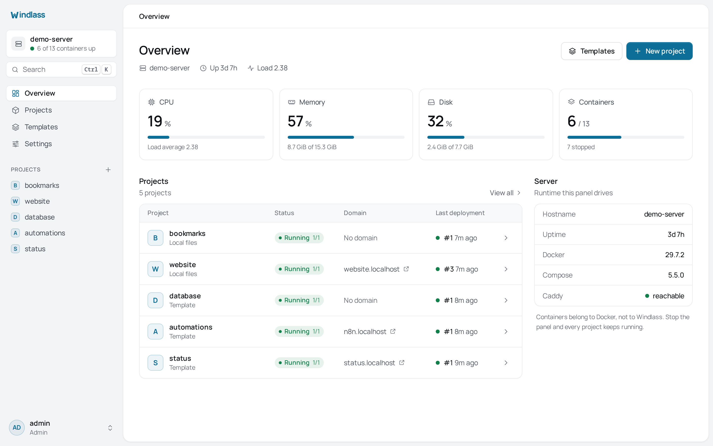

# Getting started

This walks through a first deployment on a fresh server: install Windlass, claim the
instance, create a project, put a real domain in front of it, and confirm the container
survives without the panel.

Budget about fifteen minutes, most of it waiting for image pulls.

## Before you start

You need a Linux server with a public IP and root or sudo. If Docker is missing, the
installer asks before installing it from get.docker.com, and stops if you say no. To
agree without the prompt, add `--yes`: `curl -fsSL https://get.windlass.run | sudo sh -s -- --yes`.

If you want HTTPS on a real hostname, point an A record at the server now. DNS
propagation is usually the slowest part of this page, so starting it first saves waiting
later.

## 1. Install

```sh
curl -fsSL https://get.windlass.run | sudo sh
```

The installer creates an unprivileged `windlass` user, installs a systemd unit, and puts
a restricted Docker socket proxy in front of the daemon. Windlass reaches Docker through
that proxy on loopback and is never added to the `docker` group, so a panel compromise
does not hand over the daemon.

When it finishes it prints the URL to open, which is the server's IP on port 8080, and
the command that shows the setup token.

## 2. Claim the instance



Open that URL. Windlass asks for a one-time setup token, then the email and password of
the first account. The token is printed to the server log at first start, so only someone
who can read that log can claim the instance:

```sh
sudo journalctl -u windlass | grep setup_token
```

Once an account exists, setup refuses every request, so the instance cannot be claimed
twice.

Choose a real password of at least ten characters. This account is an administrator on a
machine that runs containers as root.

Turn on two-factor authentication straight away under **Settings, Users and sign-in** if
the panel will be reachable from the internet. See [Users and access](./users-and-access.md).

## 3. Create a project

A project is a directory on the server holding a `compose.yaml`, an optional `.env`, and
whatever else your stack needs. Nothing about it is Windlass-specific.

Create one from **Projects, New project**. You get a starter compose file serving nginx,
which is enough to prove the path end to end before you put your own stack in.

Or start from **Templates** for something ready to run: Ghost, Gitea, PostgreSQL, Redis,
MinIO, n8n and others. A template becomes an ordinary Compose project with generated
credentials in its Environment tab. There is no proprietary layer to migrate off later.

## 4. Deploy it

Open the project, go to **Deployments**, press **Deploy**.

A deployment runs a fixed sequence, and the log streams as it goes:

```
Prepare -> Sync -> Pull -> Build -> Start -> Verify
```

The last step matters. Windlass waits for Docker healthchecks to report healthy, and for
any `windlass.health.*` checks you set, before calling a deployment succeeded. A stack
that starts and immediately crash-loops is reported as failed rather than green.

If the panel restarts mid-deployment, the deployment resumes on startup rather than
leaving the project half-updated.

## 5. Put a domain in front of it

In the project's **Domains** tab, add your hostname and pick the service and port to
route to.

Once the service has a running container, Windlass writes a route into Caddy and adds the
hostname to Caddy's certificate automation. Caddy then requests a certificate, from Let's
Encrypt by default, and renews it on its own. There is no certificate paperwork to do.

Windlass only ever touches its own Caddy objects, by ID. Routes you wrote by hand are
left exactly as they are. See [Domains and HTTPS](./domains-and-https.md).

## 6. Prove it does not depend on the panel

Worth doing once on your own server, because it is the claim everything else rests on:

```sh
sudo systemctl stop windlass
curl -I https://your-domain.example
```

Your site still answers. The containers are ordinary Compose containers with a restart
policy, started by `docker compose`, and Docker keeps them running. Caddy keeps serving
the routes already in its configuration.

```sh
sudo systemctl start windlass
```

[Life without the panel](./life-without-the-panel.md) covers the full story, including
how to run the same stacks by hand if you remove Windlass entirely.

## Where to go next

- [Projects and Compose](./projects-and-compose.md), how project directories and `.env` work
- [Deployments](./deployments.md), the state machine, health gating and rollback
- [Backups and restore](./backups-and-restore.md), archives, S3 and schedules
- [Configuration reference](./configuration.md), every `WINDLASS_*` variable
- [Troubleshooting](./troubleshooting.md), when a deployment or certificate misbehaves
