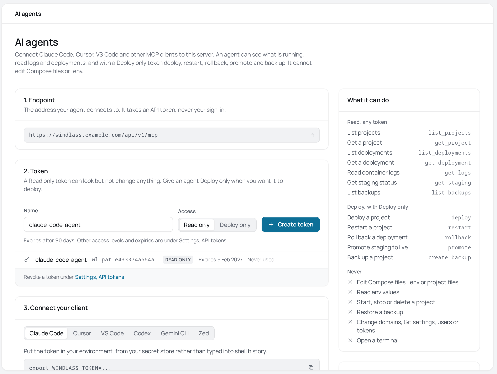

# AI agents (MCP)

Windlass serves a [Model Context Protocol](https://modelcontextprotocol.io) server at
`/api/v1/mcp` on your panel. Connect Claude Code, Cursor, VS Code, Codex, Gemini CLI or Zed to
it with an API token and an agent can answer "what is running, is it healthy, what changed, what do the logs
say, is staging ahead of live". With a Deploy only token it can also deploy, restart, roll
back, promote staging and take a backup.

It cannot edit Compose files or `.env`. Agents change code in Git and deploy it; the compose
file stays the authority, as it is everywhere else in Windlass.

From v0.61, the quickest way in is the panel: open **AI agents** in the sidebar. It shows your endpoint,
creates a Read only or Deploy only token, and gives the setup for each client below with your
panel's address filled in. This page is the same thing in long form.



## Before you start

- Windlass v0.60 or later. An admin sees the running version under **Settings, System**.
- The panel on an HTTPS domain, set in **Settings, General, Panel domain**. The token travels
  in a header on every call, and over plain HTTP anyone on the path can read it.
- An MCP client that connects to remote servers over HTTP with a bearer token. The six
  below do; see [Clients that need OAuth](#clients-that-need-oauth) for the ones that do not.

## Connect

1. As an admin, create a **Read only** token in **Settings, API tokens**, or a **Deploy only**
   one when you want the agent to deploy.
2. Put it in your environment from your secret store, not typed into shell history:
   `export WINDLASS_TOKEN=wl_pat_...`
3. Add the server to your client as below, with your panel's address in place of
   `https://panel.example`.

The token acts as you, within the access you picked. It is the same token the
[API](./api.md) takes, and every check the API makes applies to it.

### Claude Code

```sh
claude mcp add --transport http windlass https://panel.example/api/v1/mcp \
  --header "Authorization: Bearer $WINDLASS_TOKEN"
```

That writes the token itself into Claude Code's configuration. To keep it out, put the server
in a project's `.mcp.json` instead; Claude Code fills `${WINDLASS_TOKEN}` from the environment
it starts in:

```json
{
  "mcpServers": {
    "windlass": {
      "type": "http",
      "url": "https://panel.example/api/v1/mcp",
      "headers": { "Authorization": "Bearer ${WINDLASS_TOKEN}" }
    }
  }
}
```

### Cursor

In `~/.cursor/mcp.json`, or `.cursor/mcp.json` in a project. Cursor reads `WINDLASS_TOKEN` from
the environment it was started in:

```json
{
  "mcpServers": {
    "windlass": {
      "url": "https://panel.example/api/v1/mcp",
      "headers": { "Authorization": "Bearer ${env:WINDLASS_TOKEN}" }
    }
  }
}
```

### VS Code

In `.vscode/mcp.json`. VS Code asks for the token when the server first starts:

```json
{
  "inputs": [
    { "type": "promptString", "id": "windlass-token", "description": "Windlass API token", "password": true }
  ],
  "servers": {
    "windlass": {
      "type": "http",
      "url": "https://panel.example/api/v1/mcp",
      "headers": { "Authorization": "Bearer ${input:windlass-token}" }
    }
  }
}
```

### Codex

In `~/.codex/config.toml`. Codex reads the token from `WINDLASS_TOKEN`:

```toml
[mcp_servers.windlass]
url = "https://panel.example/api/v1/mcp"
bearer_token_env_var = "WINDLASS_TOKEN"
```

### Gemini CLI

In `~/.gemini/settings.json`. Use `httpUrl`: `url` means the older SSE transport. Gemini CLI
fills `${WINDLASS_TOKEN}` from its environment:

```json
{
  "mcpServers": {
    "windlass": {
      "httpUrl": "https://panel.example/api/v1/mcp",
      "headers": { "Authorization": "Bearer ${WINDLASS_TOKEN}" }
    }
  }
}
```

### Zed

Zed does not fill environment variables into a remote server's headers, so a token there would
sit in `settings.json` as plain text. To keep it out, run
[mcp-remote](https://www.npmjs.com/package/mcp-remote), an open-source bridge from npm, through
`sh`, which puts `WINDLASS_TOKEN` into the header. mcp-remote does not expand `${...}` itself. It
needs Node and works on macOS and Linux. The token passes through mcp-remote and sits in its
process arguments, where other users on the same machine can see it with `ps`. In
`~/.config/zed/settings.json`, with Zed started from a shell where `WINDLASS_TOKEN` is set:

```json
{
  "context_servers": {
    "windlass": {
      "command": "sh",
      "args": ["-c", "exec npx -y mcp-remote https://panel.example/api/v1/mcp --header \"Authorization:Bearer $WINDLASS_TOKEN\""]
    }
  }
}
```

### Clients that need OAuth

ChatGPT, Claude.ai and Claude Desktop add remote servers only through an OAuth sign-in, which
Windlass does not have yet, so they cannot connect.

### Check it

Ask the agent "which projects are on my Windlass server?". It should call `list_projects`.
Without an agent:

```sh
curl -sS https://panel.example/api/v1/mcp \
  -H "Authorization: Bearer $WINDLASS_TOKEN" -H 'Content-Type: application/json' \
  -H 'MCP-Protocol-Version: 2025-11-25' \
  -d '{"jsonrpc":"2.0","id":1,"method":"tools/list","params":{}}'
```

## Tools

`tools/list` shows a token only the tools it can use.

| Tool | Needs | What it does |
| --- | --- | --- |
| `list_projects` | any | The projects the token can see |
| `get_project` | any | Services with container state and exit code, health, domains, last deployment |
| `list_deployments` | any | Deployments newest first: number, status, trigger, commit |
| `get_deployment` | any | One deployment and its event log, where a failure's reason is |
| `get_logs` | any | The newest log lines of one service, scrubbed (below) |
| `get_staging` | any | Which deployment staging and live are on, and whether a promote is possible |
| `list_backups` | any | Backups newest first: kind, destination, size, status |
| `deploy` | deploy | Deploys now, as the panel's Deploy button does; a Git project pulls its branch first |
| `restart` | deploy | Restarts the project's containers |
| `rollback` | deploy | Redeploys an earlier deployment, images pinned to its digests |
| `promote` | deploy | Promotes a staging deployment to live |
| `create_backup` | deploy | Takes a backup now, to local storage or S3 |

"deploy" means a Deploy only, Deploy and edit or Admin token whose owner is a member or admin.

## What an agent never sees or does

- **Env values.** No tool returns `.env` or env values, whatever the token's access or its
  env values setting.
- **Secrets in logs, mostly.** Log output has `[redacted]` in place of any Windlass API token
  and of the project's env values: those in `.env` and those its top-level Compose files set
  inline (`environment` and build `args`, the default in `${NAME:-value}` included, and in
  config `content` each line's value and each long line with no spaces, such as a key's
  body). If Windlass cannot read those values, or a Compose file will not parse, it withholds
  the log text rather than send it unscrubbed. See [What scrubbing misses](#what-scrubbing-misses).
- **Changes beyond the five writes.** No editing Compose, env, files, Git settings or
  domains; no start, stop, delete, restore, staging create, terminal, users or tokens. The
  REST routes for those refuse a Deploy only token too.
- **A browser.** The endpoint takes a bearer token only, never the panel's session cookie,
  and refuses any request that carries an `Origin` header, so a web page cannot reach it.

### What scrubbing misses

The match is exact, so these get through:

- a value shorter than 6 characters, or shorter than 4 under a name such as `DB_PASSWORD`,
  `API_TOKEN` or `SECRET_KEY`
- a value from another env file named by `env_file`
- a line of a multi-line config `content` that is neither `key = value` nor 16 characters
  with no spaces
- a value the app prints encoded or in pieces

Keep secrets out of logs regardless.

## Writes

`deploy`, `restart`, `rollback`, `promote` and `create_backup` are marked destructive and need
`confirm: true`. The server tells the agent to ask you before each one and to prefer staging and promote over
changing live directly. That relies on the agent: a model can set `confirm` without asking,
and in testing one did when told plainly to redeploy. Treat `confirm` as a speed bump. The
real controls are your client's prompt to approve each tool call (leave it on for these five)
and the token's access, so give an agent a Read only token unless you want it to deploy.

`create_backup` is in that list because a manual backup counts toward the project's retention:
the next scheduled backup can delete the oldest to make room. It takes one every 10 minutes at
most. Restoring stays in the panel.

Deploy, rollback and promote answer once the deployment is queued, with the number to follow
through `get_deployment`. A restart or backup waits up to a minute; past that the tool answers
`still_running` and says how to check. The work carries on even if the agent disconnects.

Each write appears twice in the audit log: the route's own entry naming the token, and an
`mcp.call` entry naming the tool.

## Limits

- 120 tool calls a minute per token.
- Logs: the newest 100 lines by default, at most 500 lines and 64 KiB. No following.
- Lists are capped and say so: 50 deployments, 200 backups.
- A read call gives up after 20 seconds.

## Protocol

Streamable HTTP, stateless: JSON responses only, no sessions and no server-sent events; GET
and DELETE answer 405. Three revisions are accepted:

- **2026-07-28**, with `server/discover` and the `MCP-Protocol-Version`, `Mcp-Method` and
  `Mcp-Name` headers
- **2025-11-25**, with `initialize`, answered without a session id
- **2025-06-18**, served as 2025-11-25, which has the same tool shapes

There is no OAuth sign-in yet, so a client that can connect to remote servers only through
OAuth cannot use it. See [Clients that need OAuth](#clients-that-need-oauth).

## Troubleshooting

- **401.** The token is missing, mistyped, expired or revoked.
  `GET /api/v1/auth/tokens/current` says which token a request used and what it may do.
- **403 from Cloudflare.** A bot challenge in front of the panel; see
  [Behind Cloudflare](./api.md#behind-cloudflare).
- **403 from Windlass.** The client sent an `Origin` header, which a browser-based client
  does. Use a desktop client or a CLI.
- **"needs a token that can deploy".** Create a Deploy only token. If you have one, its
  owner may have been made a viewer since.
- **"rate limited".** More than 120 calls in a minute. Wait and retry.
