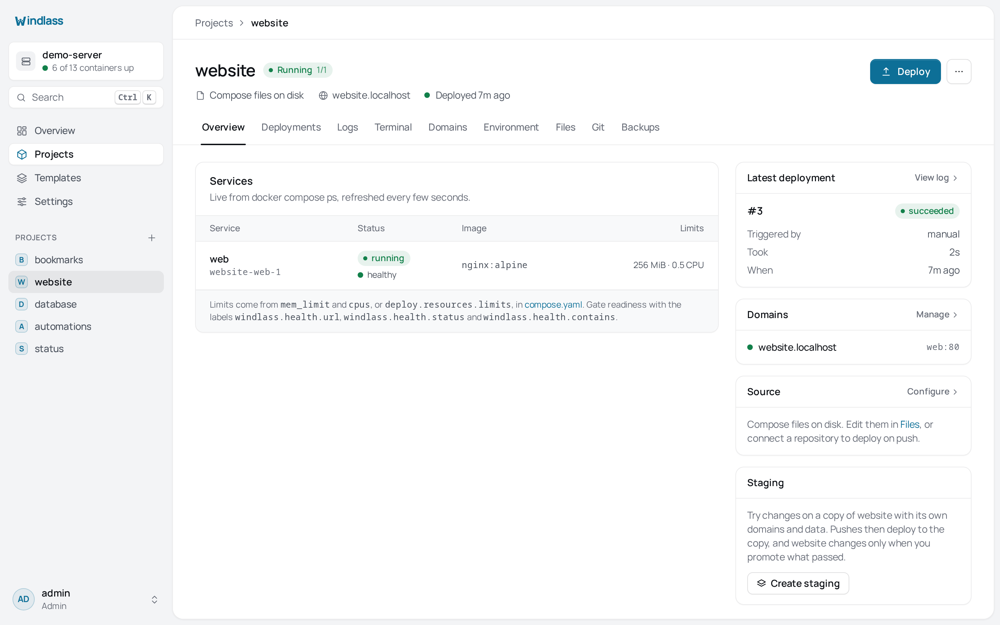
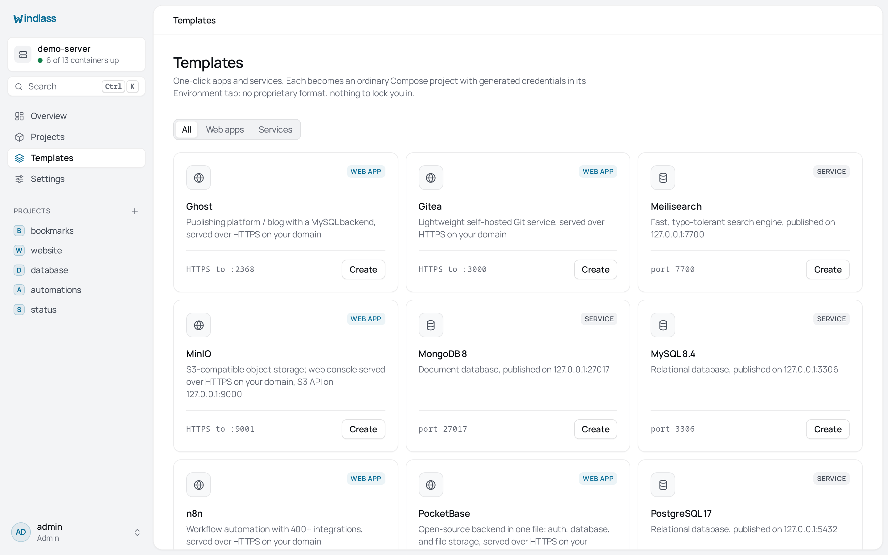

# Projects and Compose

A project is a directory. That is the whole idea, and most of what is surprising about
Windlass follows from it.

```text
<projects>/<name>/
├── compose.yaml       # services, images, ports, volumes, networks, limits
├── .env               # optional dotenv file, mode 0600
├── .windlass.json     # source repository, branch, auto-deploy, domains
└── src/               # a Git project's checkout, when it has one
```

The default projects directory is `/var/lib/windlass/projects`, which you can move with
`WINDLASS_PROJECTS`. See the [configuration reference](./configuration.md).



## The filesystem wins

Windlass runs the real `docker compose` CLI in that directory. It does not parse your
compose file into an internal model and regenerate it, so nothing is lost in translation:
no unsupported key silently dropped, no reformatting of a file you carefully commented.

Which means editing over SSH is a supported workflow, not a workaround:

```sh
cd /var/lib/windlass/projects/shop-api
vim compose.yaml
docker compose up -d
```

The panel's Files and Environment screens read the same bytes. If you change a file on
disk, the panel shows your change; if you change it in the panel, the file on disk
changes. There is no sync step and no conflict resolution, because there is only one copy.

SQLite holds platform state (users, sessions, audit entries, deployment history) and a
rebuildable index of projects and domains. It is not a second copy of your configuration.
Delete the database and your containers keep running; **Scan directory** on the Projects
page rebuilds the index from the filesystem.

## Adopting stacks you already have

If the server already runs Compose projects, move their directories under the projects
directory and use **Scan directory**. Windlass indexes what it finds, including containers
already running, without redeploying anything.

A directory is picked up when its name is lowercase letters, digits, `-` and `_`, starting
with a letter or digit, and it holds a `compose.yaml` or `compose.yml`. A file named
`docker-compose.yml` is not recognised, so rename it. Symlinks are not followed: move the
directory itself.

This is also the recovery path after restoring a machine from a backup: put the
directories back, scan, and the panel knows about them again.

## The environment file

`.env` is a standard dotenv file, one `KEY=value` per line, written mode 0600. Compose
substitutes it into `compose.yaml` the way it always does. Windlass reads it before every
deploy and never rewrites it there, so a value changed over SSH is the value that deploys.

The Environment tab has two views of the same variables: **Table**, one row per key, and
**.env text**, where you can paste a whole file. Saving replaces the file with what is on
screen, so a key you removed is gone. Windlass writes the file sorted by key under a
two-line header and does not keep comments, so keep notes somewhere else.

Values are visible to anyone who can read the file on the server and to members and
admins in the panel. Viewers, and API tokens without **Can read env values**, see each
key with its value replaced by `********`. The same applies to the values a compose file
sets inline in `environment:` or build args, which is one more reason to keep secrets in
`.env` rather than in `compose.yaml`. Treat the file as what it is: a secrets file on a
host.

## Resource limits

Limits come from the Compose keys, not from a panel setting:

```yaml
services:
  api:
    image: nginx:alpine
    mem_limit: 256m
    cpus: 0.5
```

Compose also applies `deploy.resources.limits` outside Swarm, so this works too:

```yaml
services:
  api:
    image: nginx:alpine
    deploy:
      resources:
        limits:
          memory: 256m
          cpus: "0.5"
```

The project overview shows the limit each service gets, from either form. When both are
set, `mem_limit` and `cpus` are the ones shown.

## Application health

Docker healthchecks are honoured. Beyond those, labels let a deployment wait for your
application rather than for the container process:

```yaml
services:
  api:
    ports:
      - "127.0.0.1:8081:8080"
    labels:
      windlass.health.url: http://127.0.0.1:8081/health
      windlass.health.status: "200"
      windlass.health.contains: "ok"
      windlass.health.stability_seconds: "10"
```

Only `windlass.health.url` is required. `status` defaults to 200, `contains` is optional,
and `stability_seconds` (default 10) is how long the check must keep passing before it
counts. Windlass fetches the URL itself, not from inside the container, so on a systemd
install it needs a port the service publishes on the host, as above.

A deployment is only reported succeeded once these pass, and it fails if they have not
within two minutes. See [Deployments](./deployments.md) for how that fits into the
sequence.

## Git projects

A Git project is still a project directory with its own `compose.yaml`. Windlass checks
the repository out into `src/` inside that directory, and the project's `compose.yaml` is
what runs, not a compose file in the repository. Point the build at the checkout:

```yaml
services:
  web:
    build: ./src
```

See [Deployments](./deployments.md#git-deployments) for connecting a repository.

## Templates



Templates create ordinary projects. A template writes a normal `compose.yaml` and a normal
`.env` with generated credentials, then gets out of the way. The generated file even says
so at the top:

```text
# This is a plain compose project. Edit it like any other.
```

There is no template runtime, no upgrade channel, and nothing that breaks if you rewrite
the file the day after creating it.
