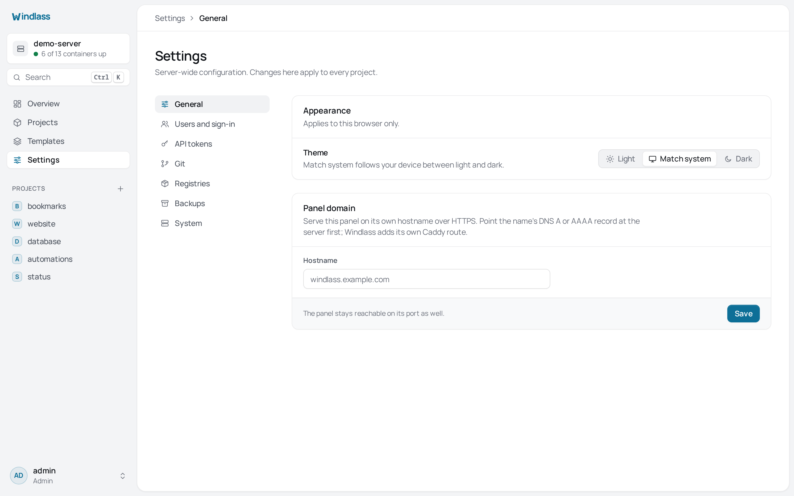

# Users and access

## Claiming an instance

A new install has no accounts. Windlass prints a one-time setup token to its log, and the
setup page asks for it before creating the first account, which is an admin:

```sh
sudo journalctl -u windlass | grep setup_token
```

Reading the server log proves you control the server, so whoever reaches the panel first
cannot claim it. A restart before the instance is claimed prints a new token. Once the
first account exists the setup route refuses every request, so an instance cannot be
claimed twice.

## Roles

Three roles, in increasing order:

| Role | Can |
| --- | --- |
| `viewer` | Read projects, deployments, logs and metrics |
| `member` | Everything a viewer can, plus deploy, edit files and environment, manage domains and backups |
| `admin` | Everything a member can, plus manage users, API tokens, settings, Git and registry credentials, and updates |

Viewers see which env keys a project sets, but not their values, and so do API tokens
created without **Can read env values**. The same goes for values
a Compose file sets inline: `environment:`, build `args:` and inline config `content:`
come back as `********`, while `${NAME}` references stay readable so a viewer can see
where a value comes from. Comments inside those blocks are hidden too, and a masked file
is shown reformatted. Secrets written elsewhere in a Compose file, such as in a
`command:` line or a label, are not masked. Keep them in `.env`.

Every state-changing request is checked against the role on the server and written to the
audit log. The check is in the handler, not in whether the button was drawn, so a hidden
control is not a permission and cannot be worked around by sending the request directly.

Deleting a project requires re-entering your password, unless the account signs in only
through OAuth.



## Two-factor authentication

TOTP is available to every account and set up from Settings: scan the QR code, confirm a
code, done. It is standard RFC 6238, so any authenticator works.

Turn it on for administrators on any panel reachable from the internet. It is not
mandatory, because a single-operator install on a private network gains little from it.

Turning it off asks for a current code, so someone holding a stolen session cannot remove
it. Accounts with TOTP that sign in with GitHub or Google are asked for a code too.

If someone loses their authenticator, an admin can turn TOTP off for them under
**Settings, Users and sign-in**, with **Reset 2FA**, and they enrol again after signing in. An admin cannot
reset their own this way. If the only admin loses theirs, stop Windlass and clear it in
the database. On a systemd install, with the `sqlite3` package installed:

```sh
sudo systemctl stop windlass
sudo sqlite3 /var/lib/windlass/data/windlass.db \
  "UPDATE users SET totp_secret_enc = NULL, totp_enabled = 0 WHERE email = 'you@example.com';"
sudo systemctl start windlass
```

## Signing in with GitHub or Google

An admin can turn on GitHub and Google sign-in under **Settings, Users and sign-in**, with
the client ID and secret of an OAuth app made with the provider. The card shows the
callback URL to register.

It signs in **existing** users matched by verified email, and does not create accounts.
Someone with a GitHub or Google account and an email you have never added cannot get in
by being first to the login page. Create the account in the panel first, then let that
person sign in.

## API tokens

Scripts, CI jobs and AI agents use API tokens rather than a password. Only admins create
them, under **Settings, API tokens**, and every token is limited to the access chosen
when it was made and to its owner's current role. Anyone can see and revoke their own.
Deleting a user deletes their tokens. See [the API guide](./api.md#api-tokens) for what a
token can and cannot do.

## Sessions

Signing in starts a session that lasts seven days. The cookie is signed and refers to a
row on the server, so signing out ends the session at once rather than waiting for it to
expire, and deleting a user ends all of their sessions.

## Exposing the panel

Give the panel a hostname under Settings so it is served over HTTPS rather than on
`:8080`. See [Domains and HTTPS](./domains-and-https.md).

Windlass reaches Docker through a restricted socket proxy on loopback, and its service
user is deliberately not in the `docker` group. The proxy limits which parts of the Docker
API are reachable at all, and keeps the panel's own process away from the raw socket.

Be clear about what it does not do. Deploying Compose files means creating containers,
and a Compose file can ask for a privileged container or mount the host's filesystem. So
anyone who can edit a project and deploy it, a `member` or an API token with deploy
access, can gain root on the host. Give `member` only to people you would trust with
root, and keep tokens with that access as carefully as an SSH key.
